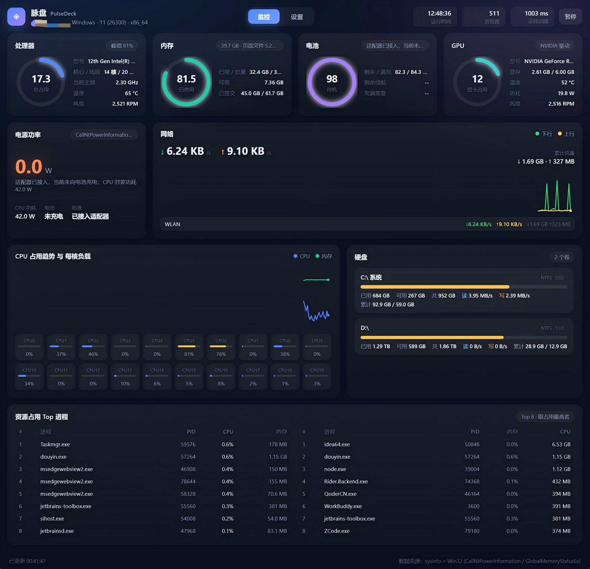
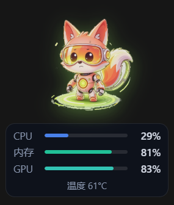
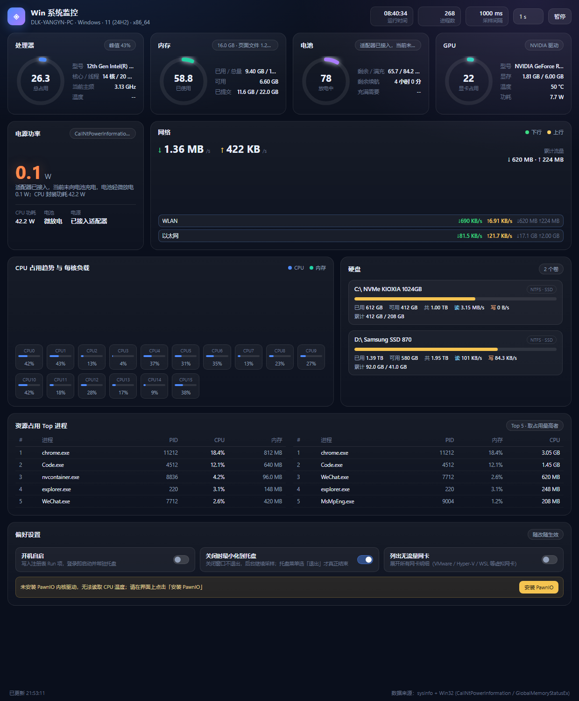

<div align="center">

# 脉盘 PulseDeck

** 桌面系统监控小工具 + 会随 CPU 温度换装的桌面宠物 + 任务栏显示**

*A lightweight desktop system monitor with a temperature-reactive desktop pet.*

[](LICENSE)
[](#下载与安装)
[](https://tauri.app)
[](https://github.com/yyn0210/PulseDeck/releases)
[](#参与贡献)

如果它对你有用，欢迎点一个 ⭐ Star 支持一下。

</div>

---

实时监控 **CPU / 内存 / 硬盘 / 电池 / 电源功率 / GPU / 网络 / 温度 / 风扇转速**。
后端 Rust + Tauri 2，前端 Vite + 原生 JS（图表全部 canvas 手绘，**零第三方图表库 / 前端框架**），
托盘常驻 + 开机自启，关闭窗口不退出。数据源**诚实降级**：能读到就报，读不到显示 `--` 并给出具体原因，
绝不拿占空比冒充转速。

<p align="center">
  
</p>

## 目录

- [功能特性](#功能特性)
- [界面一览](#界面一览)
- [下载与安装](#下载与安装)
- [快速上手](#快速上手)
- [桌面宠物](#桌面宠物)
- [任务栏显示](#任务栏显示)
- [数据来源与降级策略](#数据来源与降级策略)
- [从源码构建](#从源码构建)
- [调试与自测](#调试与自测)
- [开发深入笔记](#开发深入笔记)
- [目录结构](#目录结构)
- [已知限制](#已知限制)
- [路线图](#路线图)
- [参与贡献](#参与贡献)
- [致谢](#致谢)
- [许可证](#许可证)

## 功能特性

- **一个面板看全整机**：CPU（占用 / 每核 / 主频 / 温度 / 风扇）、内存（含已提交内存、页面文件）、
  硬盘（容量 / 读写速率 / 累计量）、电池与电源功率（含 CPU 封装功耗）、GPU（占用 / 显存 / 温度 / 功耗 / 风扇）、
  网络（速率 / 累计流量 / 每网卡明细）、Top 进程榜（CPU / 内存各 8）
- **温度与风扇读数是真的**：CPU 温度走 PawnIO + Intel MSR 直读片内 DTS（最准路径），
  联想机型还能读厂商私有的真实风扇 RPM——绝不拿占空比冒充转速
- **桌面宠物**：置顶小狐狸在桌面上跑动，显示 CPU / 内存 / GPU 使用率，
  **形象随 CPU 温度 6 档切换**（38 蓝 → 94 红），过热档还会加速喘气
- **任务栏显示**：把 CPU / 内存 / GPU / 网络 / 磁盘 / 电池 / 温度 / 功率贴在 Windows 任务栏上的一条
  细挂件里（任务栏显示模式）：停在通知区域（托盘图标 / 时钟）左侧、不抢焦点、不进 Alt+Tab，
  全屏游戏 / 视频时自动隐藏（Linux 上为贴屏幕右下角的置顶边条，见支持矩阵）
- **托盘常驻**：关窗不退出，后台继续采样；支持开机自启、暂停刷新
- **轻量原生**：Tauri 2 打包，无 Electron、无第三方图表库，canvas 手绘所有图表
- **隐私友好**：全部采集本地完成，无任何上传 / 遥测
- **提权最小化**：主程序普通权限运行；读 MSR / 风扇由按需拉起的提权子进程完成，
  一次 UAC 搞定，绝不静默安装驱动

## 界面一览

| 卡片     | 内容                                                          |
| ------ | ----------------------------------------------------------- |
| 处理器    | 总占用环形图、型号、物理核/线程数、当前主频、**温度**、**风扇转速**、每核负载网格               |
| 内存     | 已用/总量、可用、已提交内存（Commit Charge）、页面文件                          |
| GPU    | 占用环形图、型号、显存占用、温度、功耗、**风扇转速**；多卡时列出全部并取主卡汇总                  |
| 电池     | 剩余电量、剩余/满充容量（Wh）、剩余续航、充满所需时间、充放电状态                          |
| 电源功率   | 电池实时功率（W，充入 / 输出 / 已接入未充电时给 0）、**CPU 封装功耗（W）**、电池状态、是否接入适配器 |
| 网络     | 总下行/上行速率、累计流量、速率趋势折线（自适应量程）、每张网卡明细                          |
| 硬盘     | 每个卷的容量占比、读/写速率、开机以来累计读写量、文件系统与介质类型                          |
| Top 进程 | CPU 占用 Top 8 / 内存占用 Top 8                                   |

顶部导航在 **监控** / **设置** 两个页面间切换（会记住上次停留的页面）：

| 设置页分组  | 内容                                              |
| ------ | ----------------------------------------------- |
| 常规     | 开机自启、关闭时最小化到托盘、是否列出无流量网卡                        |
| 采样     | 刷新间隔（500 ms / 1 s / 2 s / 5 s）                  |
| 桌面宠物   | 是否启用、显示内容（CPU / 内存 / GPU 使用率）、不透明度；形象按 CPU 温度分 6 档切换 |
| 任务栏显示  | 是否启用、显示内容（CPU / 内存 / GPU / 网络 / 磁盘 / 电池 / 温度 / 功率）、挂件状态行 |
| 高级采集   | 各采集通道状态（PawnIO 内核驱动、厂商风扇通道）+ 未就绪时的操作入口          |

> 窗口默认 **1240×820**、可自由缩放。内容量会随硬件规模（核心数 / 卷数 / 网卡数）变化，
> 当内容高于窗口时，**页面内部会出现纵向滚动条**——向下滚动即可看到下方全部内容。
>
> 窗口没有系统标题栏，顶上那条深色标题栏**是页面自绘的**（三平台统一观感，
> 顺带解决 Linux（Deepin / GNOME）下系统标题栏与这套深色界面格格不入的问题）：
> 左端是品牌标记，右端是最小化 / 最大化 / 关闭，整条可拖动、双击切最大化，
> 四边四角用隐形热区拖拽缩放。实现与踩过的坑见
> [自绘标题栏与窗口缩放](#自绘标题栏与窗口缩放)。

## 下载与安装

### 系统要求

**Windows**

| 项 | 要求 |
| -- | -- |
| 操作系统 | **Windows 10 x64（build 17763 / 1809）及以上**（也是随包分发 PawnIO 驱动的前置条件） |
| 架构 | 仅 x86_64 |
| WebView2 | 需要运行时（Windows 11 一般已内置；安装包缺失时会引导安装） |
| 权限 | 普通用户权限即可运行；CPU 温度 / 风扇等高级采集需管理员（按需授权一次） |

**Linux**

| 项 | 要求 |
| -- | -- |
| 操作系统 | x86_64 桌面发行版（deb 系用 `.deb`；其他发行版用 `.AppImage`） |
| 架构 | 仅 x86_64 |
| WebView | webkit2gtk 4.1（`.deb` 已声明依赖，安装时自动带上；AppImage 自带） |
| 桌面环境 | X11 或 Wayland；托盘图标需要应用指示器支持（GNOME 需装 AppIndicator 扩展） |
| 权限 | 普通用户即可；CPU 温度 / 风扇走内核 hwmon，**无需任何提权** |

### 安装

**Windows**

1. 打开 [Releases](https://github.com/yyn0210/PulseDeck/releases) 页面；
2. 下载最新版 NSIS 安装包（`PulseDeck_x.y.z_x64-setup.exe`）并双击安装；
3. 启动后即可使用，**无需联网、无需管理员**。

**Linux**

1. 打开 [Releases](https://github.com/yyn0210/PulseDeck/releases) 页面；
2. deb 系发行版（Debian / Ubuntu / Deepin / UOS 等）下载 `PulseDeck_x.y.z_amd64.deb`，
   执行 `sudo apt install ./PulseDeck_x.y.z_amd64.deb`；
3. 其他发行版下载 `PulseDeck_x.y.z_amd64.AppImage`，`chmod +x` 后直接运行
   （部分发行版需要 `libfuse2`）。

Linux 上**不需要 PawnIO**：CPU 温度 / 风扇 / 电池 / 已提交内存分别走内核 hwmon、
`/sys/class/power_supply` 与 `/proc/meminfo`，普通权限直读（见
[平台抽象层与支持矩阵](#平台抽象层与支持矩阵)），设置页也不会出现 Windows 的
「高级采集」区块。

**关于高级采集（可选，仅 Windows）**：CPU 温度最准的路径（读 MSR）与联想风扇转速需要内核驱动 PawnIO。
本工具**绝不静默安装**——未安装时只是顶部多一条可关闭的提醒，安装入口在
**设置 → 高级采集**，点按钮确认一次 UAC 即可（安装器随包分发，全程离线可用）。
不装也能正常使用，温度会回退到 ACPI / PDH 通道。详见
[CPU 温度与 PawnIO 提权桥](#cpu-温度与-pawnio-提权桥)。

## 快速上手

- **托盘与自启**：
  - 关闭主窗口默认**隐藏到托盘**，后台采样线程继续运行；托盘菜单选「退出」才真正结束；
  - 左键单击托盘图标呼出面板，右键展开菜单；
  - 托盘菜单提供：显示面板、暂停刷新、开机自启（Windows 写注册表 Run 项，Linux 写 `~/.config/autostart`）、退出；
  - 设置页「常规」可以关闭「关闭时最小化到托盘」，让关闭按钮直接退出。
- **顶部提示条**：未安装 PawnIO 时，监控页顶部会出现一条可关闭的提醒（`#tipbar`），
  点「去设置」直接跳到设置页「高级采集」；点「×」后由用户选 **「永久关闭」**（写入
  `localStorage['pd.pawnioTipMuted']`，跨启动生效）或 **「仅本次」**（只挡本次运行），也可「取消」。
  永久关闭后，设置页「高级采集」底部会留一条「重新开启」链接，避免变成单向门。
  提示条只做提醒，**不在主页面弹 UAC**——安装入口始终在设置页。
- **可调项**：
  - 采样间隔：设置页「采样 → 刷新间隔」下拉框（500 ms / 1 s / 2 s / 5 s），同步调整后端采样线程间隔；
  - 暂停/继续：停止前后端轮询，保留最后一帧数据（右上角按钮，托盘菜单里也能切）；
  - 开机自启：设置页「常规」开关，或托盘菜单直接勾选；
  - 桌面宠物 / 任务栏显示：设置页对应卡片（开关 + 显示内容），改完立即生效。

## 桌面宠物

设置页「桌面宠物」里开启后，桌面上会出现一只**置顶、无边框、透明、不进任务栏**的小宠物：
显示勾选的指标（CPU / 内存 / GPU 使用率），**形象随 CPU 温度换档**。

<p align="center">
  
</p>

- 形象是 **6 档 × 每档 8 帧**的机器人狐狸贴图（`src/assets/pet/*.png`，自带 alpha）：
  `38 蓝 → 50 绿 → 63 黄绿 → 74 黄 → 84 橙 → 94 红`（与设置页色带同一组刻度）。
  档位内 8 帧循环播放（260ms/帧，约 3.8fps；整段播完约 2 秒）；**跨档位时整段换成新档位的 8 帧序列**（从第 0 帧起播）。
  温度 `≥84℃` 的两档算「过热」：帧速加快到 200ms/帧（约 5fps），脚下温度文字变橙。
- 档位按**就近**取刻度（如 68℃ → 63 档、88℃ → 84 档；正好居中时取较冷的一档）。
- **温度读不到时**（多数机器要先装 PawnIO 驱动才有 CPU 温度）自动**退回按 CPU 占用选档**，
  并在脚下标注「温度 -- · 按占用切换形象」、悬浮提示里说明原因——**不做无声降级**。
- 整只宠物可拖动，**双击呼出主面板**（主面板常驻托盘时很方便）。
- 主面板「关闭时最小化到托盘」不影响宠物：**窗口由 Rust 侧持有**，与主窗口生命周期解耦。

## 任务栏显示

设置页「任务栏显示」里开启后，任务栏上会多出一条**细挂件**：默认停在**通知区域（托盘图标 / 时钟）左侧**，
实时显示你勾选的指标。它相当于系统监控类工具里的「任务栏显示模式」，但**不修改系统任务栏**——
是一条贴在任务栏上的置顶无边框小窗（页面可用 `taskbar.html?mock=1` 脱离真机预览，见「前端预览与 Mock」）。

- **可选内容**（设置页勾选，至少一项，按勾选顺序排列）：
  | 键 | 显示 | 缺数据时 |
  | -- | -- | -- |
  | `cpu` / `mem` / `gpu` | `CPU 34%`（占用 ≥60% 转黄、≥85% 转红） | GPU 读不到显示 `GPU --` |
  | `net` | `↓1.24MB/s ↑56KB/s`（下行绿 / 上行黄，全机合计） | — |
  | `disk` | `读 2.1MB/s 写 300KB/s`（所有卷合计） | — |
  | `bat` | `电池 78%`（≤30% 黄、≤15% 红） | 无电池显示 `电池 --` |
  | `temp` | `温度 62℃`（≥74℃ 黄、≥84℃ 红，与宠物分档同源） | 读不到显示 `温度 --` |
  | `power` | `功率 19.4W`：优先电池充/放电功率，没充没放时是 CPU 封装功耗 | 都没有显示 `功率 --` |
- **不抢焦点**：窗口带 `WS_EX_NOACTIVATE`（`focusable(false)`），点击挂件不会把焦点从你正在用的应用上抢走；
  也**不进 Alt+Tab、不在任务栏里多出按钮**（`skip_taskbar`）。
- **单击挂件呼出主面板**（和托盘图标一样方便）；主面板最小化到托盘时挂件照常贴在任务栏上。
- **全屏应用在前台时自动隐藏**（游戏 / 播放器 / 网页全屏视频），退出全屏就回来——不会压在你的视频画面上。
- **跟着任务栏走**：任务栏换成上下左右任一条边、改厚度（小图标 / 大图标）、改 DPI、
  explorer 重启（`Shell_TrayWnd` 换句柄）、切浅色 / 深色主题，挂件都会在一秒内跟过去。
  浅色任务栏用深色文字、深色任务栏用浅色文字（读的是注册表里的「Windows 模式」）。
- 开了**任务栏自动隐藏**时，挂件贴在屏幕底边——那一处正是任务栏弹出来的位置（任务栏滑走了，挂件仍然可见）。
- 配置落应用数据目录（Windows：`%LOCALAPPDATA%\PulseDeck\taskbar.json`；
  Linux：`~/.config/pulsedeck/taskbar.json`），设置页另外缓存一份在
  `localStorage['pd.taskbarConfig']`（与桌面宠物同一套双写规则）。

## 数据来源与降级策略

统一由 Rust 侧在**后台采样线程**每 N 毫秒刷新一次，前端只拉取最后一次快照，
避免多窗口/多次刷新导致重复采样。速率类指标一律用**实测采样间隔**（而非配置值）换算。

### 平台抽象层与支持矩阵

下表的接口全是 Windows 专属的。OS 绑定的采集通道（GPU / 温度 / 风扇 / 电池 /
内存附加）已收敛到 `src-tauri/src/platform/` 的 5 个 trait（`GpuSource` /
`ThermalSource` / `FanSource` / `BatterySource` / `MemoryExtras`），
由 `platform::sources()` 按编译目标分派实现。CPU / 内存基础 / 磁盘 / 网络 /
进程榜走 `sysinfo`（本身跨平台），不进该层。

| 功能 | Windows | Linux | macOS |
| --- | --- | --- | --- |
| CPU / 内存 / 磁盘 / 网络 / 进程（sysinfo） | ✅ | ✅ | ✅ |
| GPU（占用 / 显存 / 温度 / 功耗 / 风扇） | NVML + PDH 兜底 | NVML + amdgpu sysfs 兜底 | — |
| CPU 温度 | PawnIO MSR（提权桥接）→ LHM → ACPI → PDH 四级 | hwmon（coretemp / k10temp / zenpower） | — |
| CPU 封装功耗 | PDH RAPL | RAPL powercap（Intel） | — |
| 风扇转速 | 联想厂商通道 / LHM / ACPI | hwmon fan / pwm | — |
| 电池与充电功率 | CallNtPowerInformation | `/sys/class/power_supply` | — |
| 已提交内存 | GlobalMemoryStatusEx | `/proc/meminfo`（Committed_AS） | — |
| 桌面宠物 | ✅ | ✅ | ✅ |
| 任务栏挂件 | 贴任务栏条带（含全屏自动隐藏、主题跟随） | 贴屏幕右下角边条（无全屏隐藏、主题读 gsettings） | 同 Linux |
| 提权桥接（PawnIO） | ✅（设置页「高级采集」） | 不需要（hwmon 免提权） | — |

未适配平台（macOS 等）走 `platform/unsupported.rs` 诚实占位——统一返回
「当前操作系统暂不支持该指标的采集」，绝不编造数值；该占位实现**在所有平台
都参与编译**，接口漂移在 Windows / Linux 上就会被测试发现。macOS 的温度 /
风扇 / 电池功率需要一个 Mac 才能开发与验证（IOKit / SMC），暂不实现，
基础指标由 sysinfo 天然可用。

平台细节（非 Windows 的已知限制，均在对应实现处注释）：
任务栏挂件在 Linux 上退化为贴屏幕右下的置顶边条；全屏应用自动隐藏在非
Windows 不可用（Wayland 没有全局窗口枚举）；面板主题读 `gsettings`（GNOME 系），
其余桌面环境按深色处理；Linux 的「CPU 风扇号手动指定」暂不支持（FanID 是
联想 ACPI-WMI 概念）。

Windows 专属的代码（PawnIO 提权链、任务栏的原生几何查询）全部 `#[cfg(windows)]`
门控，依赖也已拆入 `[target.'cfg(windows)'.dependencies]`；CI 有 Ubuntu
`cargo test` job 在真机 hwmon / procfs 上守护 Linux 路径。接入新平台见
`platform/mod.rs` 的模块文档。

| 指标                             | 接口                                                                                                                                                                                                                                                                                                                                            |
| ------------------------------ | --------------------------------------------------------------------------------------------------------------------------------------------------------------------------------------------------------------------------------------------------------------------------------------------------------------------------------------------- |
| CPU 占用 / 每核 / 主频               | `sysinfo` (`System::refresh_cpu_all`)                                                                                                                                                                                                                                                                                                         |
| 内存、页面文件                        | `sysinfo` (`System::refresh_memory`)                                                                                                                                                                                                                                                                                                          |
| 已提交内存                          | Win32 `GlobalMemoryStatusEx`                                                                                                                                                                                                                                                                                                                  |
| 磁盘容量                           | `sysinfo::Disks`                                                                                                                                                                                                                                                                                                                              |
| 磁盘读/写速率                        | `Disk::usage()` 的 `read_bytes` / `written_bytes` 增量 ÷ 实测采样间隔                                                                                                                                                                                                                                                                                  |
| 网络收/发速率                        | `sysinfo::Networks` 的 `received()` / `transmitted()` 增量 ÷ 实测采样间隔                                                                                                                                                                                                                                                                              |
| 进程榜                            | `sysinfo` (`System::refresh_processes_specifics`，只刷新**占用率 + 内存**、不枚举线程与 IO)，进程 CPU% 已 ÷逻辑核心数换算成「占总 CPU 算力」口径，与全局 CPU 一致                                                                                                                                                                                                                                                           |
| GPU 占用 / 显存 / **温度** / 功耗      | NVIDIA：NVML（`nvml-wrapper`，动态加载 nvml.dll）                                                                                                                                                                                                                                                                                                     |
| GPU 占用 / 显存（非 N 卡）             | PDH `GPU Engine(*)\Utilization Percentage`、`GPU Adapter Memory(*)\Dedicated Usage`                                                                                                                                                                                                                                                            |
| **GPU 风扇**                     | ① NVML `nvmlDeviceGetFanSpeed`（占空比 %，桌面 N 卡常有值）／`nvmlDeviceGetFanSpeedRPM`（真转速，视型号）；② 硬件监控软件的 WMI `Sensor(SensorType='Fan')`（RPM）                                                                                                                                                                                                             |
| **CPU 风扇**                     | ① **厂商私有通道（联想机型）**：WMI `root\WMI:LENOVO_FAN_METHOD.Fan_GetCurrentFanSpeed` → **RPM**（ACPI-WMI 映射，**需管理员**，由提权桥接子进程供数）；② 硬件监控软件（OpenHardwareMonitor / 旧版 LHM ≤ 0.9.4）的 WMI `Sensor(SensorType='Fan')` → **RPM**；③ WMI `Win32_Fan.DesiredSpeed`（ACPI，**绝大多数机器该字段为空**，有值也不保证是 RPM，仅当占空比展示）                                                       |
| CPU 温度                         | ① **PawnIO + Intel MSR**：直读片内 DTS 寄存器（`0x1A2` 取 TjMax，`0x1B1` 封装、`0x19C` 逐核心），最准；需管理员，由提权桥接子进程供数（见下方「CPU 温度」）；② 硬件监控软件（OpenHardwareMonitor / 旧版 LHM ≤ 0.9.4）的 WMI `Sensor` 表；③ WMI `root\wmi:MSAcpi_ThermalZoneTemperature`（ACPI 热区，联想 LegionZone 等厂商工具的通用兜底，**联想机型免装软件即可读到 CPU 热区**）；④ PDH `Thermal Zone Information(*)\Temperature`（含有效性校验） |
| **CPU 封装功耗（W）**                | PDH `\Energy Meter(*)\Power`（Intel / AMD RAPL，单位为 mW，取 `*_pkg` 实例）                                                                                                                                                                                                                                                                            |
| 电池百分比、充放电方向、充放电功率、剩余/满充容量、预估时间 | Win32 `CallNtPowerInformation(SystemBatteryState)`                                                                                                                                                                                                                                                                                            |
| 电池降级读数                         | Win32 `GetSystemPowerStatus`                                                                                                                                                                                                                                                                                                                  |
| 显卡名称（PDH 路径）                   | WMI `Win32_VideoController`                                                                                                                                                                                                                                                                                                                   |

### Windows 上的已知坑

**电源功率 / 适配充电功率**：Windows 只公开「电池的充放电速率」（`SYSTEM_BATTERY_STATE::Rate`，单位 mW），
**并不公开适配器的额定功率或输出功率**——没有任何公开接口能给出「充电器正在输出多少 W」。

`Rate` 需按**有符号**解读（正=充电，负=放电），且 `0xFFFFFFFF` 是「固件未提供」的哨兵值
——按无符号解释会得到四百多万瓦的荒谬读数。

另外这类机器很常见的一种真实状态是「**适配器已接入，但电池不充不放**」（满电后续充 / 电池养护模式），
此时 `Rate` 为 0 或极小值（本机实测长期为 `-90 mW` 的微放电）。早期版本只在「确实在充电」时赋值
充电功率，导致卡片一直显示 `--`。现在的处理：

- 主数值取 **电池实时功率**：充电时用充入功率，未接入时用放电功率，**已接入但未充电时明确给 `0.0 W`**，不再留空
- 副行补充 **CPU 封装功耗**（RAPL，来自 PDH `\Energy Meter(*)\Power`），这是一直存在的实时功耗读数
- 说明文案按「充电中 / 已接入未充电 / 电池供电」分状态表述，并在括号里带上电池功率与 CPU 功耗

**CPU 封装功耗**：`\Energy Meter(*)\Power` 的实例名形如 `rapl_package0_pkg`（整包）、
`rapl_package0_pp0`（核心）、`rapl_package0_dram`，单位是 **mW**；`_total` 实例恒为 0，不能直接取。
部分老平台 / 虚拟机没有这个计数器，此时该读数显示 `--`，不影响其它指标。

**网络重复计数**：Windows 上同一张网卡会同时出现真实接口和 NDIS 过滤驱动两个条目
（本机 WLAN 与 WLAN-Huorong NDIS Filter 的累计流量完全相同），不去重会让汇总速率翻倍。
采样时按 MAC / 累计流量相同识别并剔除重复项。

### CPU 温度与 PawnIO 提权桥

Windows 没有统一的 hwmon 接口，CPU 温度只存在于片内 DTS 寄存器里，**必须经内核驱动读 MSR**。
本工具按优先级多源尝试：

1. **PawnIO + Intel MSR**（最准，推荐）：借通用 IO 驱动 [PawnIO](https://pawnio.eu) 执行官方签名的
   `IntelMSR` 模块，直接读 MSR —— `0x1A2` 取 TjMax、`0x1B1` 取封装 DTS、`0x19C` 逐核心取 DTS，
   `温度 = TjMax − DTS`。读 MSR 需要管理员权限，故这一步放在**提权子进程**里做（详见下文）；
2. **硬件监控软件的 WMI `Sensor` 表**：只对 **OpenHardwareMonitor** 或**旧版 LHM（≤ 0.9.4）**有效 ——
   LibreHardwareMonitor 自 **0.9.5 起已删除自带的 WMI 提供程序**，`root\LibreHardwareMonitor` 在新版上不存在；
3. **WMI `root\wmi:MSAcpi_ThermalZoneTemperature`**（ACPI 热区，厂商工具如联想 LegionZone 也拿它当通用兜底 ——
   联想等机型的 BIOS 会暴露 CPU 热区，免装任何软件即可读到）；
4. **PDH `Thermal Zone Information(*)\Temperature`**（含有效性校验）。

本机（台式 / 虚拟机）实测既无 ACPI 热区实例、`Thermal Zone Information` 又恒定返回
`273`（对应 0°C，是无实现的假读数），因此代码会先换算成摄氏度、再用合理区间过滤掉这类值。
若以上通道都拿不到（例如非 Intel 平台且固件不暴露热区），界面显示 `--` 并给出具体原因 ——
`%LOCALAPPDATA%\PulseDeck\pawnio.log` 里会有提权桥接进程留下的失败明细。

> **只内置了 Intel 模块，AMD 平台暂不支持 MSR 直读**（会给出明确提示并回退 ACPI / PDH）。

> 逆向笔记：联想 LegionZone 取 CPU 温度的主路径是私有 WMI 提供程序 `root\wmi:LZWmiX80`
> （方法 `Query_CAPABILITY_DATA_00/01` 返回 `LENOVO_CAPABILITY_DATA_xx` 二进制 blob，内嵌
> `CPU DTS Sensor Temperature` 片上数字温度传感器读数），其通用兜底才是上面的 `MSAcpi_ThermalZoneTemperature`。
> `LZWmiX80` 的 blob 格式未公开，无法盲接；本工具走的是更通用的 MSR 直读路径。
> 完整分析见 `docs/LegionZone采集机制分析.md`。

**PawnIO 是什么**：一个**通用**内核驱动：它本身不含硬件逻辑，只负责执行**已签名的模块字节码**，
因此不需要用户安装任何硬件监控软件。本工具把官方发布的 `IntelMSR.bin`
（来源 [namazso/PawnIO.Modules](https://github.com/namazso/PawnIO.Modules) v0.1.6，LGPL-2.1，
见 `src-tauri/resources/pawnio/NOTICE.md`）随安装包分发。

**为什么要拆成两个进程**：读 MSR 需要管理员权限，而主程序是普通权限运行的。所以：

1. 主程序启动时先探测 PawnIO 设备（`CreateFileW` 的失败码即可区分「没装」/「装了但没权限」）；
   **未安装就直接不拉**，交给界面引导（见下节）；已安装则检查
   `%LOCALAPPDATA%\PulseDeck\pawnio.json`，**没有新鲜读数**才拉起桥接进程，
   且**一个会话只尝试一次**，不会反复弹 UAC；
2. 桥接进程是**本 exe 自己**（命令行带 `--pawnio-bridge --module <path> --out <path> --parent-pid <pid>`），
   用 `ShellExecuteExW` 的 `runas` 动词 + 隐藏窗口启动 —— 首次运行会弹**一次 UAC**；
3. 它打开 `\\?\GLOBALROOT\Device\PawnIO`、载入模块、每秒读一次温度，把结果**原子写入**（临时文件 + 改名）
   那个 JSON；主进程只是读文件，因此完全不需要跨权限 IPC；
4. 它**启动时打开一次父进程句柄并一直持有**，之后每秒用 `WaitForSingleObject` 等待它——
   父进程一退出（进程对象被置为有信号态）就自行收尾 —— 不需要（也不该）在这里做跨权限
   `TerminateProcess`，那在普通权限下大概率会失败。

> ⚠️ 判据**必须**是句柄等待，**不能**是「`OpenProcess` 打不开就算父进程退出」：Windows 上
> 进程退出后只要有别的句柄还引用它的进程对象（WebView2 之类很常见），`OpenProcess(父PID)`
> 会继续成功，子进程就会永远以为父进程活着、应用关了它还赖在后台（2026-10-10 修的
> 「残留进程」正是此因）。详见 `msr_bridge.rs` 的 `ParentWatch` 与回归测试
> `parent_watch_notices_exit_even_when_object_survives`。

### PawnIO 未安装时的一键引导

装 PawnIO 需要管理员权限（它是内核驱动），所以本工具**绝不静默安装**，而是分两种情况：

| 情况            | 行为                                                                                                             |
| ------------- | -------------------------------------------------------------------------------------------------------------- |
| 启动时探测到**未安装** | **不**拉起提权子进程（拉起来也只能报错、还白弹一次 UAC）。监控页顶部给一条**可关闭的提示条**提醒去设置页，设置页「高级采集」里显示状态 + 提示，并给出 **「安装 PawnIO」按钮**           |
| 用户点了按钮        | 拉起提权子进程并带 `--install-if-missing`（= 已获授权）；子进程**已经是管理员**，于是直接跑随包安装器 `-install -silent`，装完接着读温度 —— **全程只弹一次 UAC** |
| 已安装           | 正常拉起子进程读 MSR                                                                                                   |

<p align="center">
  
</p>

安装器**随安装包原样分发**（源码里就是官方 2.2.0 的 `PawnIO_setup.exe`，未做任何修改），
所以目标机器不需要联网、也不需要用户自己去下载。命令行与退出码：

```text
Usage: PawnIOSetup.exe [-install] [-uninstall] [-unrestricted] [-debuginfo] [-silent]
```

`-install -silent` 静默安装；退出码 `0` = 成功，`3010` = 成功但需重启，其他为 DOS 错误码。
用户**不装也能正常使用**本工具，只是温度会回退到 ACPI / PDH。

> **再分发条款**：安装器二进制是专有的「All rights reserved. This installer can be
> redistributed **unmodified**.」——所以它必须**原样**分发，不要改字节 / 换图标 / 重新签名
> （它带官方 Authenticode 签名，篡改会破坏签名）。先例：LibreHardwareMonitor 内嵌它、
> Chocolatey 官方 `pawnio` 包分发它、NWinfo 也分发它。详见
> `src-tauri/resources/pawnio/NOTICE.md`。
>
> 前置条件：**Windows 10 x64 1809（build 17763）及以上**；若系统已装更旧的 PawnIO，
> 安装器会拒绝并要求先卸载——本工具不会强行覆盖，只把原始退出码回传给界面。

### 风扇转速

这是个比温度更封闭的指标，**Windows 没有任何公开的用户态接口**。
本工具的策略是「**能读到就报、读不到就明确说读不到**」，绝不拿占空比冒充转速：

| 通道                                                               | 覆盖情况                                          | 单位          |
| ---------------------------------------------------------------- | --------------------------------------------- | ----------- |
| **厂商私有（联想）** `root\WMI:LENOVO_FAN_METHOD.Fan_GetCurrentFanSpeed` | **联想机型有效**（ACPI-WMI 映射，**需管理员**，走提权桥接）        | **RPM（可信）** |
| NVML `nvmlDeviceGetFanSpeed` / `…FanSpeedRPM`                    | 桌面 N 卡常有值；**笔记本独显普遍报 `N/A`**（风扇由 EC 控制，驱动读不到） | %（占空比）/ RPM |
| LHM / OHM 的 WMI `Sensor(SensorType='Fan')`                       | 需装 OpenHardwareMonitor 或旧版 LHM（≤ 0.9.4）       | **RPM（可信）** |
| ACPI `Win32_Fan.DesiredSpeed`                                    | 类存在但**绝大多数机器该字段为空**；有值也不保证是 RPM               | 相对速度        |

前端展示口径：**优先真实 RPM，其次占空比 `%`，两者都没有才显示 `--`**，
并在设置页「高级采集」下方给出具体原因（CPU 与 GPU 的成因不同，分开说明）。

**联想机型**：CPU 风扇可通过厂商私有的 **ACPI-WMI 通道**读取（联想官方 LegionZone 用的就是它），
但实测**需要管理员权限**。本工具把它接进与 CPU 温度同一个**提权子进程**（一次 UAC 同时搞定两者），
所以联想机型上温度与风扇是「一荣俱荣」的。检测到联想设备且风扇不可用时，
界面会在提示区显示「**启用**」按钮，点击并确认一次 UAC 即可。

> **刷新节奏**：风扇读数与 CPU 温度**同一个来源、同一个节拍**——桥接子进程 **1Hz** 写出，
> 主进程**每拍直接读**（本地小文件，微秒级），界面跟着采样间隔走。
> 主进程侧**没有任何时间窗缓存**：桥接每秒给一次，界面就每秒更新一次。
> （采样间隔选 500 ms 时，风扇受桥接 1Hz 的产出速率限制，会呈现"两次一更新"，
> 这是数据源的真实节拍，不是丢帧。）
> 提权后本机实测 CPU 风扇 ≈ 2800 RPM、GPU 风扇 ≈ 2785 RPM（相邻两拍通常有 3~10 RPM 抖动）。

> 本机（RTX 3060 Laptop + 12th Gen Intel）实测：`nvml.fan_speed(0)` 返回 `Err(InvalidArg)`、
> `Win32_Fan.DesiredSpeed` 为空、未装 OHM/LHM → 通用通道全读不到；
> 但**联想通道提权后可读到 CPU 风扇 ≈ 3007 RPM、GPU 风扇 ≈ 2978 RPM**。
> 用 `cargo test -p pulse-deck diag::probe_fan -- --nocapture` 可以复现通用通道的判断过程。
>
> CPU 侧还有个更深的现状：CPU 风扇在非联想机型上挂在主板 Super I/O / EC 上，即便是本工具已有的
> PawnIO 通道也帮不上忙 —— 实测 `IntelMSR.bin` 只导出 `ioctl_read_msr` / `cpuid` / `msr_read` /
> `get_arch`，**不含任何 EC 读取函数**。要拿真实 RPM 只能另配 Super I/O 模块（机型强相关），暂不引入。

## 从源码构建

### 环境要求

公共：

- [Rust](https://rustup.rs)（stable）
- [Node.js](https://nodejs.org) ≥ 20.19（Vite 7 的要求）与 npm
- Python 3.11 + Pillow / numpy / scipy —— 仅**改宠物贴图**时需要（见[宠物贴图管线](#宠物贴图管线)）

Windows：

- `x86_64-pc-windows-msvc` 目标 + VS2022 的 MSVC 工具链（cl.exe / link.exe）
- WebView2 运行时（开发机一般已有）

Linux（deb 系示例）：

```bash
sudo apt install -y libwebkit2gtk-4.1-dev build-essential curl wget file \
  libxdo-dev libssl-dev libayatana-appindicator3-dev librsvg2-dev
```

### 构建命令

```bash
git clone https://github.com/yyn0210/PulseDeck.git
cd PulseDeck
npm ci             # 按 package-lock.json 精确安装（改过 package.json 依赖后改用 npm install 刷新锁文件）
npm run dev        # 开发模式（Vite dev server :1420 + Tauri 窗口；期间保持 Vite 存活）
npm run build      # 完整打包：前端 + 二进制 + 当前平台的安装包
npm run build:exe  # 只出二进制（跳过安装包）
```

打包目标按平台拆在 `tauri.windows.conf.json`（NSIS + PawnIO 随包资源）与
`tauri.linux.conf.json`（deb + AppImage，不带 Windows 专属资源）里，构建时自动合并。

产物位置：

| 平台 | 二进制 | 安装包 |
| -- | -- | -- |
| Windows | `src-tauri/target/release/pulse-deck.exe` | `src-tauri/target/release/bundle/nsis/*.exe` |
| Linux | `src-tauri/target/release/pulse-deck` | `src-tauri/target/release/bundle/deb/*.deb`、`bundle/appimage/*.AppImage` |

### ⚠️ 不要直接 `cargo build --release`

`src-tauri/Cargo.toml` 里 `custom-protocol = ["tauri/custom-protocol"]` 是一个**非默认** feature，
它决定 Tauri 加载「内置前端资源」还是「devUrl 上的 Vite 开发服务器」：

```rust
// tauri/build.rs
let dev = !custom_protocol;        // 没启用 custom-protocol → 判定为 dev
println!("cargo:dev={dev}");
```

`dev=true` 时窗口会去请求 `http://localhost:1420`，双击 exe 就会看到
`localhost 拒绝连接（ERR_CONNECTION_REFUSED）`——**不是页面坏了，是构建姿势不对**。
只有 `tauri build`（CLI）会自动追加该 feature，所以务必走 npm 脚本。
`npm run dev` 期间请保持 Vite 进程存活，否则窗口刷新同样会报连接被拒绝。

## 调试与自测

`lib.rs` 里留了一组分段诊断用例，加指标或换机器排查时很有用：

```bash
# 完整快照（会打出一份完整 JSON）
cargo test -p pulse-deck smoke::collect_once -- --nocapture

# 逐层确认原生数据源
cargo test -p pulse-deck diag::nvml          -- --nocapture   # NVIDIA 驱动读数
cargo test -p pulse-deck diag::probe_gpu     -- --nocapture   # GPU 探测（NVML → PDH）
cargo test -p pulse-deck diag::probe_thermal -- --nocapture   # 温度 + CPU 封装功耗
cargo test -p pulse-deck diag::probe_fan     -- --nocapture   # 风扇转速（NVML / LHM/OHM / ACPI 逐层确认）
cargo test -p pulse-deck diag::probe_battery -- --nocapture   # 电池原始字段（SYSTEM_BATTERY_STATE / WMI）
cargo test -p pulse-deck diag::wmi           -- --nocapture   # WMI 连通性
cargo test -p pulse-deck diag::pawnio_msr    -- --nocapture   # PawnIO 设备 / 模块 / MSR 温度（提权运行才有意义）
cargo test -p pulse-deck diag::pawnio_setup  -- --nocapture   # PawnIO 是否已安装 + 随包安装器是否就位
```

WMI 逐步 HRESULT 日志：`WB_WMI_DIAG=1 cargo test -p pulse-deck diag::wmi -- --nocapture`

> `diag::*` 用例直连 Windows 原生数据源（PDH / WMI / PawnIO），随平台一起 `cfg` 门控，
> **只在 Windows 上编译**；`smoke::collect_once` 两平台通用。Linux 上排查采集问题时
> 用它打完整快照，hwmon 细节可用 `sensors` 命令对照。

### 桥接进程会不会留成孤儿

`msr_bridge.rs` 的存活判据有两条用例锁着（`cargo test -p pulse-deck msr_bridge::tests`）。
其中 `parent_watch_notices_exit_even_when_object_survives` 复刻了「进程已退出但进程对象还没被
回收」的场景 —— 旧判据（`OpenProcess` 打不开才算退出）在这个场景下恒为「还活着」，
就是 2026-10-10 那个「应用关了还有残留进程」的根因，**别把它改回去**。

要看真实二进制（而不是测试里造的场面）的表现，跑验收脚本 —— 不弹 UAC、不开窗口：

```bash
npm run build             # 先出包，脚本读 src-tauri/target/release/pulse-deck.exe
python tools/verify_bridge_exit.py
```

它会拉起一个自己控制的假父进程 + 一个 `--pawnio-bridge` 实例，确认「父进程活着→桥接保持
存活」「父进程结束→桥接 1 拍内自行退出」，并顺带打印旧判据在同一时刻的错误结论作对照。

## 开发深入笔记

> 以下是为贡献者保留的深入说明（改敏感区域前**必读**）。快速索引见 `AGENTS.md`。

### 布局约束

`#app` 固定为 `height:100vh; overflow:hidden`，
滚动只发生在页面容器内部——**监控页 `.grid`**、**设置页 `.settings-page`**（两者都是
`flex:1 1 auto; min-height:0; overflow-y:auto`）。切页只切这两个 `<main>` 的 `hidden` 类，
外壳（titlebar / topbar / banner / tipbar / statusbar）保持不变。
关键是 `.grid` 必须声明 **`grid-auto-rows: max-content`**——否则 `.card{min-height:0}`
会让隐式行的 min-content 贡献为 0，配合默认 `align-content:stretch` 把行均摊拉伸到容器高度、
压扁卡片。删掉这一行滚动就会失效。

`#app` 的**上内边距是 0**：第一行是自绘标题栏，它用 `margin: 0 calc(-1 * var(--pad-x)) …`
左右抵消 `#app` 的内边距，好让整条（含两个上角）都能拖——和系统标题栏的手感一致。
`--pad-x`（默认 16px）就是为这处负外边距留的，改 `#app` 的左右内边距时改它一个地方即可。

### 自绘标题栏与窗口缩放

窗口统一**无系统标题栏**（`tauri.conf.json` 里主窗口 `decorations: false`，三平台一致），
标题栏与缩放由页面自己提供，三处配合：

| 位置 | 负责 |
| --- | --- |
| `index.html` 的 `.titlebar` | 标题栏 DOM：左品牌标记、右三颗窗口按钮，整条打了 `data-tauri-drag-region="deep"`（拖动 + 双击最大化由 Tauri 的 `drag.js` 承担，按钮是 clickable 元素会被自动摘出拖动区） |
| `index.html` 的 `.resize-frame` | 四边（5px）+ 四角（14px）隐形热区，铺满窗口但容器 `pointer-events:none`，只有细条吃事件 |
| `src/main.js` 的 `initWindowChrome()` | 把按钮接到 `minimize / toggleMaximize / close`，热区接到 `startResizeDragging`；用 `onResized` 同步最大化状态 |

几个要点：

- **`is-maximized` 挂在 `<html>` 上**：最大化时把最大/还原两个图标对调（两个 `<svg>` 用 CSS
  切显隐），并把 `.resize-frame` 整体收起来（最大化后本来就拖不动四边）。
- **权限**：`core:window:allow-start-resize-dragging` 必须留在 `capabilities/default.json` 里
  （`start-dragging` / `minimize` / `toggle-maximize` / `close` 早就在）。注意 capability 文件是
  **严格 JSON**，写了 `//` 注释整个构建会以 `failed to parse JSON` 失败。
- **想回到系统标题栏**：把 `tauri.conf.json` 的 `decorations` 改回 `true` 即可——`initWindowChrome()`
  读到 `isDecorated() === true` 会给 `<html>` 挂 `.native-chrome`，自绘标题栏与热区一起让位、
  `#app` 恢复 14px 上内边距。**别只删 HTML**：那样窗口会既没有系统标题栏也没有自绘那条，
  拖不动也关不掉。
- **Windows 上的取舍**：无边框窗口靠 tauri 的 `shadow: true`（默认）拿回投影、Win11 圆角与最外圈
  的系统缩放边框；失去的是 **Win11 贴靠布局**（悬停最大化按钮弹的那套），Win+方向键不受影响。
- **还不是窗口真身的验证**：`npm run ui` + `http://localhost:1420/?mock=1` 就能看标题栏排版
  （mock 里 `is_decorated` 照实答 `false`，最大化按钮可点，会真的切图标与热区）。
  真机上「拖得动、缩放正常」仍需在桌面会话里手验。

### 宠物窗口是第二个 WebView

**① 附加参数必须每个窗口一致。** Windows 下同一份 WebView2 用户数据目录只能对应
「一组」`additionalBrowserArgs`。主窗口用 A、宠物窗口用 B（包括 B 是 wry 默认串），
建第二个 WebView 时 WebView2 直接返回 `HRESULT(0x8007139F)`(ERROR_INVALID_STATE)，
没有任何 UI 提示，桌面表现就是「宠物开关打开了但什么都不出现」。
当前**三个窗口（main / pet / taskbar）都不带附加参数**（曾加过 anti-throttling 参数，后证实无用且已移除）；
`pet.rs` 的 `BROWSER_ARGS` 常量 + `browser_args_match_conf` 单测卡住这份一致性：
要加参数必须在**每一处建窗代码**里加同一份（宠物 `pet.rs`、任务栏挂件 `taskbar.rs`，
后者由 `window_reuses_main_environment_and_browser_args` 单测卡住）。

**② 共享同一个 `ICoreWebView2Environment`（官方推荐做法）。**
`pet.rs` 的 `create_window`（以及任务栏挂件的 `taskbar::create_window`）会显式复用主窗口的环境
（`shared_webview_environment` 用 `with_webview` 从主窗口拿环境，
`WebviewWindowBuilder::with_environment` 传给第二个窗口），
多个 WebView 共用同一浏览器进程。**改创建逻辑时这一行不能删。**

宠物窗口的生命周期由 Rust 侧持有（`pet.rs` 的 `sync_window()`），与主窗口解耦
（主窗口关到托盘不影响宠物）。实现要点：

| 部分 | 位置与说明                                                                                                         |
| -- | ------------------------------------------------------------------------------------------------------------- |
| 配置 | `pet.json`（`%LOCALAPPDATA%\PulseDeck\`），启动时由 Rust 读回，**不依赖主窗口先起来**                                           |
| 窗口 | `src-tauri/src/pet.rs`：`sync_window()` 按配置建 / 销毁；默认落在主显示器工作区右下角。窗口 **190×224**（高度跟着 15:16 的贴图走）        |
| 读数 | 专用命令 `get_pet_metrics`（只回 CPU / 内存 / GPU / 温度四个数，不搬整份快照）                                                      |
| 形象 | `src/assets/pet/t<档位>_<帧>.png`（6×8），由 `tools/copy_pet_frames.py` 从 `src/assets/img/pet/*.png` 抠底生成                |
| 心跳 | 页面每秒 `pet_heartbeat`；设置页据此显示「运行中 / 未响应」                                                                       |
| 命令 | `get_pet_config` / `set_pet_config` / `get_pet_metrics` / `pet_heartbeat` / `pet_status` / `show_main_window` |
| 前端 | `pet.html` + `src/pet.js` + `src/pet.css`（独立入口，**vite 多入口**，与主面板共用构建）                                         |
| 权限 | `capabilities/default.json` 的 `windows` 需含 `pet`（当前窗口标签只在 Rust 侧创建）                                           |

### 任务栏挂件的落点与看护

挂件（`src-tauri/src/taskbar.rs`）与宠物同为「Rust 侧持有的第二个 WebView」，但**位置是算出来的**，
不是拖出来的——所以 `taskbar.json` 里没有 `position`，页面也没有拖动区。三件事值得记牢：

**① 落点算法是纯函数，全部按物理像素算（`stripe_of` + `dock_rect`，有单测）。**
先用 `FindWindowW("Shell_TrayWnd")` 拿任务栏矩形，但**不能照搬它**：任务栏自动隐藏时它会整个滑到屏幕外，
照搬就把挂件也甩出去（表现是「开关打开了但什么都看不见」）。所以只取它的**厚度**与**在哪条边**，
再把条带重新贴到显示器边缘；随后右端（竖排时下端）锚在 `TrayNotifyWnd`（通知区域）左侧留 `gap`
的位置——数字变宽时窗口往左长，右边沿不动，看着才像钉住的。拿不到通知区域时退回固定预留宽度。

**② 位置 / 尺寸 / topmost 由看护线程每秒重算**（`spawn_watcher`），不靠页面定时器：
窗口被全屏应用藏起来时 Chromium 会把页面定时器节流到分钟级，「藏了回不来」就成必然。
线程在 `create_window` 时拉起、窗口销毁时自行结束。

- 重顶 topmost 必须自己发 `SetWindowPos(HWND_TOPMOST, …SWP_NOACTIVATE)`：
  tao 的 `set_always_on_top` 只在**标志位变化**时才发 `SetWindowPos`（`apply_diff` 里 diff 为空直接返回），
  已经是 topmost 的窗口再调一次什么都不会发生；而任务栏被点一下就会盖到普通置顶窗口上面。
- 「全屏」判定要求**贴满整块显示器且不是最大化窗口**（`covers_monitor`）：任务栏自动隐藏时，
  最大化窗口同样铺满整块屏幕，只看矩形的话用户一最大化窗口挂件就消失了。

**③ 宽度由页面量、后端设**（`taskbar_fit`）：多宽取决于勾了几个指标、数字有多长。
Rust 侧只在建窗时给一个估算值（`estimate_logical_size`），落地后由页面量出的自然尺寸覆盖——
在 Rust 里硬编码「每个指标占多少像素」会在换字体 / 改文案时全错。
页面里 `.tb` 必须 `flex: 0 0 auto`（不能收缩）：被压窄就会量出偏小的宽度回给后端，
窗口一直比内容小、数字被裁掉。

| 部分 | 位置与说明 |
| -- | -- |
| 配置 | `taskbar.json`（`%LOCALAPPDATA%\PulseDeck\`），启动时由 Rust 读回；前端另存 `localStorage['pd.taskbarConfig']` |
| 窗口 | `taskbar.rs`：`sync_window()` 按配置建 / 销毁；置顶、无边框、透明、不进任务栏、`focusable(false)`（不抢焦点） |
| 读数 | 专用命令 `taskbar_tick`（读数 + 任务栏朝向 / 主题，顺带当心跳），不搬整份快照 |
| 落点 | `stripe_of` / `dock_rect`（纯函数 + 单测）；`taskbar_fit` 收页面量出的尺寸；看护线程每秒重算 |
| 主题 | 注册表 `SystemUsesLightTheme`（不是 `AppsUseLightTheme`——那管的是应用窗口）决定浅色 / 深色 |
| 命令 | `get_taskbar_config` / `set_taskbar_config` / `taskbar_tick` / `taskbar_fit` / `taskbar_status` |
| 前端 | `taskbar.html` + `src/taskbar.js` + `src/taskbar.css`（vite 第三个入口，与主面板共用构建） |
| 权限 | `capabilities/default.json` 的 `windows` 需含 `taskbar` |

`set_taskbar_config` 与 `set_pet_config` 一样**必须是 async 命令**：同步命令跑在主线程的 WebView2
IPC 回调里，`WebviewWindowBuilder::build()` 在那里会死锁（机理见 `pet::sync_window` 的注释），
`set_taskbar_config_is_async_command` 单测卡着。

### 宠物贴图管线

> **素材来源**：形象由**豆包（字节跳动）AI 图像生成**制作（2026-10，本项目专用素材；
> 依豆包用户协议，平台不主张对生成内容的所有权、权利归用户），抠底 / 缩放等加工均由
> 本仓库脚本完成。来源与素材声明同步记录在 [THIRD-PARTY-NOTICES.md](THIRD-PARTY-NOTICES.md)。

`src/assets/img/pet/` 是**不参与打包**的源图（浅灰底、无 alpha，1920×2048，单张约 800KB，
命名 `pet_<档位>_<帧号>.png`）；`tools/copy_pet_frames.py` 抠底生成
`src/assets/pet/t<档位>_<帧>.png`（等比缩到 320px 宽的 RGBA PNG，48 张合计约 8.7MB，
前端 glob 模式 `t*_*.png`）：

```bash
python tools/copy_pet_frames.py            # 生成/覆盖 src/assets/pet/*.png（依赖系统 Python 3.11 的 Pillow+numpy+scipy）
python tools/check_pet_frames.py           # 自检：拿源图当基准，查出"白毛被抠破 / 背景没抠净"，有问题非零退出
python tools/preview_pet_frames.py         # 人眼验收：出 shots/pet_frames_{dark,magenta}.png 两张联络表
```

改抠图参数后必须跑后两个脚本；换素材比例变了（非 15:16）要同步 `pet.rs` 的 `WIN_H`；
档位必须是 38/50/63/74/84/94 之一且增减要同步 `src/pet.js` 的 `SCALE` 与设置页色带
（前端按文件名数字识别档位；帧数不设限，按 glob 结果自适应）。

**为什么用 PNG 而不是 WebP**：WebP 的 YUV 4:2:0 让 alpha 边缘和 RGB 错位，抠图边缘会发彩边
（用户反馈过「颜色不太对」）。PNG 的 RGBA 四通道对齐，美术原色不串。

**为什么不能「直接用原图」**：原图是**不透明**的（浅灰底约 RGB 242/241/243，还带一点蓝紫渐变），
直接当贴图会带一个大方块。必须抠底。

**抠底的关键难点 —— 白色毛和背景几乎同色**。实测小狐狸的口鼻 / 耳内 / 胸口白毛，与背景色的
最大通道差只有 **0.01~0.07**；而背景本身是渐变（角落能偏出全局中位数 0.10）。所以：

- **纯阈值必然失败**：任何「离背景色多远」的阈值都会把白毛和背景一起判成透明
  —— 这正是曾经"把嘴抠没了"的原因（嘴周围的白色口鼻被抠成窟窿，只剩一条孤零零的深色嘴线）。
- 不用形态学（`binary_opening/closing`）补救：嘴线只有 2~3px 宽，会被当噪声一起擦掉。

现在的做法是 **连通性**（`process()`，四步）：

1. **局部背景模型**：先用粗阈值（`COARSE_TOL=0.15`）从画面四边洪水填充拿到可信背景，再按
   24 格粗网格取中位数、空缺格用最近邻补齐、双线性上采样，得到一张**跟得上渐变的"局部背景色"图**。
2. **软 alpha**：按「离**局部**背景色的最大通道差」做 `BG_FULL=0.06 → BG_EDGE=0.10` 的线性羽化。
3. **洪水填充定内外**：从画面四边出发，沿 `dist < FLOOD_GATE=0.10` 的像素 4 连通蔓延，
   蔓延到的是「外面」（背景）；**蔓延不到的像素一律 alpha=1**。白色口鼻虽然颜色像背景，
   但被橘色毛 / 深色线围死、从边缘蔓延不进去 → 保住。
   因为 `FLOOD_GATE ≥ BG_EDGE`（默认两者都取 0.10），内外交界处 alpha 已经连续过渡到 1，
   **不会出现硬边**。
4. RGB **全程保持美术原色**：不反预乘、不调色、不模糊、不做形态学。

> 真要去掉残余的浅色底噪，调 `BG_FULL/BG_EDGE`（抬高压住底色、降低更容易透明）；
> `FLOOD_GATE` 是"漏不漏"的闸门 —— 调低能堵住白色毛与背景之间的细通道（减少内部空洞），
> 但不得低于 `BG_EDGE`，否则内硬外软会在边界上留一圈硬边。
> 改完务必跑 `tools/check_pet_frames.py` 复检。

### 宠物配置双写与排查

配置有**两道来源**：前端 `localStorage['pd.petConfig']`（用户刚改的，启动时优先推给后端）与
后端 `pet.json`（后端自己恢复窗口用）。提交后一律以 **`set_pet_config` 的返回值**回显，
因为后端会清洗配置（剔除非法指标、**至少保留一项**、透明度夹到 0.3~1.0）。

窗口位置（`pet.json` 的 `position`，逻辑像素）**只由拖动产生**，前端的三件套里没有它：
拖动时 `WindowEvent::Moved` 每秒几十个事件、只改内存，落盘搭在宠物页每秒一次的心跳
（`pet_heartbeat` → `flush_position`）与窗口销毁事件上；后端 `set()` 里用 `adopt_position`
把前端传来的空位置覆盖回内存那份，所以设置页保存配置不会把位置清掉。
保存的位置已经不在任何显示器上时（拔掉外接屏）建窗回退默认落点，不会出现「宠物落在看不见的地方且无法找回」。

**排查「宠物窗口在，但桌面上什么都没有」**：透明无边框窗口一旦 WebView 没渲染出来，
界面上就是「纯透明 = 什么都没有」，肉眼分不清是关了还是坏了。所以：

1. 设置页「桌面宠物」里有 **宠物窗口** 状态行：`运行中` / `窗口在，但页面没有心跳` / `窗口未创建`；
2. 需要落盘时用 `PULSEDECK_PET_TRACE=1` 启动应用，页面每次心跳会覆盖写
   `%LOCALAPPDATA%\PulseDeck\pet.trace`（形如 `beat ts_ms=… window_open=true`）——
   文件在长就是页面在跑，不在就是 WebView 没起来；
3. 想用 DevTools 看页面本身，在 `tauri.conf.json` 的窗口配置里加
   `"additionalBrowserArgs": "--remote-debugging-port=9333"`，同时把
   `pet.rs` 的 `BROWSER_ARGS` 改成同一串（两个窗口参数必须一致，
   否则宠物窗口会以 `0x8007139F` 静默建不出来；`browser_args_match_conf` 单测会拦住漂移），
   然后重新出包。
   **注意 `WEBVIEW2_ADDITIONAL_BROWSER_ARGUMENTS` 环境变量在这里不起作用**——
   wry 总会自己设置这一项，WebView2 以 API 传入的值为准，环境变量会被忽略。

### 前端预览与 Mock

主面板、宠物、任务栏挂件都能脱离真机预览（`npm run ui` 后打开）：

```text
http://localhost:1420/?mock=1                               # 主面板（含自绘标题栏；最大化按钮可点）
http://localhost:1420/?mock=1&pawnio=missing&lenovo=1       # 未装 PawnIO、联想机型待启用
http://localhost:1420/pet.html?mock=1                      # 常规档
http://localhost:1420/pet.html?mock=1&hot=1                # 过热档
http://localhost:1420/pet.html?mock=1&temp=74              # 固定温度逐档核对（取值 38/50/63/74/84/94）
http://localhost:1420/pet.html?mock=1&pawnio=missing       # 温度不可用，退回按占用选档
http://localhost:1420/pet.html?mock=1&pawnio=missing&nogpu=1  # 连 GPU 占用也读不到
```

任务栏挂件同理（注意：浏览器里的挂件不会真的贴到任务栏上——
落点 / 尺寸由 Rust 侧算，这里看的是「内容长什么样」，不校验位置）：

```text
http://localhost:1420/taskbar.html?mock=1                    # 默认（深色任务栏）：CPU / 内存 / 网络
http://localhost:1420/taskbar.html?mock=1&theme=light        # 浅色任务栏配色
http://localhost:1420/taskbar.html?mock=1&vertical=1         # 任务栏竖排（贴屏幕左右侧）时的列式布局
```

> 挂件在浏览器里是「一块贴着视口左上角的胶囊」——页面本身没有背景，
> 深色背景下看更接近真机观感；`taskbar_fit` 在预览里是空实现（不会真的调窗口大小）。

> 截图/预览要注意：`vite build` 会清空 `dist/`，之后必须**重启** `python -m http.server --directory dist`
> ——服务进程的工作目录会跟着旧的 `dist` 一起失效，继续用会一律 404。

### 在沙箱里启动 GUI 做验证不可信

2026-10-11 排查「宠物心跳只走一拍就冻结」耗时一整天，最终证实是**测试环境假象**：

- 从 WorkBuddy 等 AI 工具的沙箱 shell 启动 `pulse-deck.exe`，沙箱会把
  `tsbx.dll` 注入整个进程树，随之进入 WebView2 的 **browser 进程**；
- Chromium 完整性自检在启动 **~5.5s** 时触发 `FAIL_FAST (0x80000003)`，
  browser 进程崩溃、渲染器被整体带走——页面 JS 跑完第一拍就永远静止；
- 窗口 HWND 还在（原生壳由 wry 持有）、`SendMessageTimeout` 灵敏、主进程存活，
  一切「看起来活着」，只有页面死了；
- 崩溃证据在 `%LOCALAPPDATA%\com.jianluo.pulsedeck\EBWebView\Crashpad\reports\*.dmp`
  （minidump，`ptype=browser`、模块列表里能看到注入的 `tsbx.dll`）；
  **别家 Tauri 应用（Clash Verge）从同一沙箱启动也照样崩**——是机器级现象；
- 用户双击启动（沙箱外）完全正常：主窗口、宠物都渲染，数据持续刷新。

**推论：凡是从工具 shell 启动 GUI 应用验证「页面是否在跑」，一律不可信。**
心跳类回归（`tools/verify_pet_beat.py`、`tools/check_render.py`）必须从沙箱外运行，
或由用户手动启动后观察。排查时先看 Crashpad dump，比猜前端/CSS/节流快得多。

### 其它开发约定

- 采样只在 Rust 后台线程（`sampler.rs`，由 `lib.rs` 装配），前端每拍 `invoke` 拉最后一次快照——不要在前端重复采样；
- `src-tauri/src/sampler.rs` 的 `TOP_N` 控制进程榜长度；
- localStorage 键用 `pd.` 前缀（`pd.petConfig` / `pd.pawnioTipMuted` / `pd.activeView`）；品牌改名时用过 `wm.`，但代码早已改成 `pd.` 且不做旧键迁移；
- 无 lint / typecheck 配置（无 TypeScript、无 ESLint），约束靠单测与本文档锁定；
- 注释、文档、commit message 均为中文；commit 用约定式前缀（如 `feat(fan):` / `chore(brand):` / `refactor(pet):`）。

## 目录结构

```
├─ index.html / pet.html / taskbar.html   前端三个入口（主面板 / 桌面宠物 / 任务栏挂件）
├─ vite.config.js               多入口构建（index + pet + taskbar 共用一份产物）
├─ package.json
├─ src/                         前端（Vite）
│  ├─ main.js                   主面板：轮询 + 渲染
│  ├─ pet.js + pet.css          宠物页面
│  ├─ taskbar.js + taskbar.css  任务栏挂件页面（尺寸量完回传后端）
│  ├─ style.css
│  ├─ modules/{format.js,charts.js}
│  ├─ assets/pet/               抠底后的宠物贴图（打包用，6 档 × 8 帧）
│  └─ assets/img/pet/           宠物源图（不参与打包，浅灰底无 alpha）
├─ src-tauri/
│  ├─ tauri.conf.json
│  ├─ capabilities/default.json
│  ├─ resources/pawnio/         IntelMSR.bin（温度模块）+ PawnIO_setup.exe（官方安装器，原样分发）
│  │                            来源 / 许可 / 再分发条款见同目录 NOTICE.md
│  └─ src/
│     ├─ main.rs                二进制入口
│     ├─ lib.rs                 Tauri 装配 + 托盘 + 采样线程 + 命令（含 diag/smoke 测试）
│     ├─ sampler.rs             采样编排（CPU/内存/磁盘/网络/进程/GPU/温度；TOP_N 控制进程榜长度）
│     ├─ platform/              跨平台采集抽象：windows.rs / linux.rs / unsupported.rs
│     │                         （按编译目标分派的 5 个 trait 实现）+ linux_parse.rs（纯函数与单测）
│     ├─ gpu.rs                 GPU：NVML 优先，PDH 兜底
│     ├─ fan.rs                 风扇转速：厂商私有(联想) → NVML → LHM/OHM WMI → ACPI，读不到就诚实降级
│     ├─ vendor.rs              厂商私有通道的调度与结果挑选（读取桥接产出的 JSON）
│     ├─ thermal.rs             CPU/GPU 温度 + CPU 封装功耗：多源探测 + 有效性过滤
│     ├─ pdh.rs                 PDH 性能计数器封装
│     ├─ wmi.rs                 WMI(COM) 查询封装（ACPI 热区、显卡名、OHM/旧版 LHM 传感器、联想 ACPI-WMI 方法调用）
│     ├─ pawnio.rs              PawnIO 驱动直连：载入模块、读 MSR、解 DTS 温度
│     ├─ pawnio_setup.rs        PawnIO 探测（设备能否打开）+ 静默安装随包安装器
│     ├─ msr_bridge.rs          提权子进程：读 MSR + 联想风扇，写 pawnio.json（主进程只读该文件）
│     ├─ pet.rs                 宠物窗口生命周期（Rust 持有；BROWSER_ARGS 一致性单测在此）
│     ├─ taskbar.rs             任务栏挂件：落点几何（纯函数）/ 看护线程 / 主题 / 读数
│     ├─ battery.rs             电池读数整理
│     ├─ win32.rs               Win32 薄封装（电源、内存提交量）
│     └─ model.rs               与前端交换的数据模型
├─ tools/                       Python 辅助脚本
│  ├─ copy_pet_frames.py        宠物贴图抠底（连通性洪水填充）
│  ├─ check_pet_frames.py       贴图自检（有问题非零退出）
│  ├─ preview_pet_frames.py     贴图联络表（人眼验收）
│  ├─ make_icons.py             图标生成（Pillow）
│  ├─ verify_bridge_exit.py     桥接进程收尾验收
│  ├─ verify_pet_beat.py        宠物心跳回归（必须沙箱外运行）
│  └─ check_render.py           渲染自检（必须沙箱外运行）
├─ docs/                        逆向与方案评估笔记（改风扇/温度采集前必读）
└─ shots/                       README / 验收用截图
```

## 已知限制

- **支持 Windows x64 与 Linux x64**（安装包见[下载与安装](#下载与安装)）；macOS 暂无计划——
  温度 / 风扇 / 电池功率等高级指标需要 IOKit / SMC，得有 Mac 才能开发验证；
  两平台各自的采集通道差异见[平台抽象层与支持矩阵](#平台抽象层与支持矩阵)；
- **AMD 平台暂不支持 MSR 直读**：CPU 温度回退 ACPI 热区 / PDH，能否读到取决于固件；
- **非联想机型的 CPU 风扇读不到**：风扇挂在主板 Super I/O / EC 上，通用接口不存在；
  为什么不引入 lhm-service / Super I/O 直读，见 `docs/风扇转速方案评估.md`；
- **笔记本 N 卡风扇普遍 `N/A`**（由 EC 控制，NVML 读不到），桌面 N 卡常有值；
- 部分老平台 / 虚拟机没有 RAPL 能量计数器，CPU 封装功耗显示 `--`；
- Windows 不公开适配器输出功率，「电源功率」只能给电池侧功率 + CPU 封装功耗；
- 桌面宠物目前是固定一套机器人狐狸素材，暂不支持自定义形象；
- **窗口用的是自绘标题栏**（三平台一致，见[自绘标题栏与窗口缩放](#自绘标题栏与窗口缩放)），
  代价是 Windows 11 的**贴靠布局**（悬停最大化按钮弹出的那套分屏菜单）不再出现——
  `Win` + 方向键的分屏不受影响；最大化 / 最小化 / 关闭 / 边缘拖拽缩放都正常；
- **任务栏挂件只贴主显示器的任务栏**（`Shell_TrayWnd` 就在主显示器上）：
  开了「在所有显示器上显示任务栏」时，副屏那几条任务栏上不会出现挂件；
- 挂件的位置去 **通知区域左侧**，不占任务栏按钮区：勾了特别多指标（或屏幕很窄）时
  会压住左边的任务栏按钮，此时建议少勾几项；
- 任务栏开「自动隐藏」时挂件固定贴在屏幕底边（那里是任务栏弹出来的位置），
  关掉自动隐藏才会重新回到通知区域左侧。

## 路线图

- 采样数据落盘 CSV，用于长时间基线分析
- 进程级 GPU 归属（`GPU Engine` 计数器里本来就带 pid，可以做成 GPU 版进程榜）
- 告警阈值：CPU 温度 / GPU 温度超阈值时托盘气泡提醒

## 参与贡献

欢迎 Issue 与 PR！

1. Fork 本仓库并创建你的分支（如 `feat/xxx`）；
2. 按[从源码构建](#从源码构建)搭好环境，`npm run dev` 跑起来；
3. 提交前跑通测试：`cargo test -p pulse-deck`；动了宠物贴图还要过
   `python tools/check_pet_frames.py`；
4. commit message 用中文约定式前缀（`feat(fan):` / `fix(pet):` / `docs:` …），一个提交做一件事；
5. 发 PR 时简单说清改了什么、在什么机型上验证过（CPU / GPU / 系统版本）。

**改敏感区域前请先读**：本文的[开发深入笔记](#开发深入笔记)、`AGENTS.md` 的硬性红线，
以及 `docs/` 下的采集机制分析。数据采集类 Issue 建议附上机型信息与
`%LOCALAPPDATA%\PulseDeck\pawnio.log`（如存在），方便定位通道问题。

## 致谢

- [Tauri](https://tauri.app) / [wry](https://github.com/tauri-apps/wry) —— 应用框架与 WebView 封装
- [sysinfo](https://github.com/GuillaumeGomez/sysinfo) —— CPU / 内存 / 磁盘 / 网络采样
- [nvml-wrapper](https://github.com/Cldfire/nvml-wrapper) —— NVIDIA NVML 绑定
- [PawnIO](https://pawnio.eu)（[namazso](https://github.com/namazso)）—— 通用内核 IO 驱动；
  IntelMSR 模块来自 [namazso/PawnIO.Modules](https://github.com/namazso/PawnIO.Modules)
- [OpenHardwareMonitor](https://openhardwaremonitor.org) / [LibreHardwareMonitor](https://github.com/LibreHardwareMonitor/LibreHardwareMonitor)
  —— WMI `Sensor` 通道的兼容对象与 PawnIO 安装器分发先例
- 厂商风扇通道的适配参考了联想 LegionZone 的可观察行为；同一组标准 WMI 接口亦被 LenovoLegionToolkit 等开源社区工具广泛使用

## 许可证

本项目自身代码以 **Apache-2.0** 发布，见 [LICENSE](LICENSE)。

随包分发的第三方组件有其独立条款，均记录在 `src-tauri/resources/pawnio/NOTICE.md`：

| 组件 | 许可 | 分发要求 |
| -- | -- | -- |
| `PawnIO_setup.exe`（官方安装器） | 专有（All rights reserved） | **仅允许原样（unmodified）再分发**，改一个字节即违约且破坏 Authenticode 签名 |
| `IntelMSR.bin`（PawnIO 模块） | LGPL-2.1 | 来源 namazso/PawnIO.Modules v0.1.6 |

随包分发的**全部第三方内容**——上表组件、宠物贴图的 AI 素材来源、全部 Rust/npm 依赖清单
及其许可证全文——汇总记录在 [THIRD-PARTY-NOTICES.md](THIRD-PARTY-NOTICES.md)。
